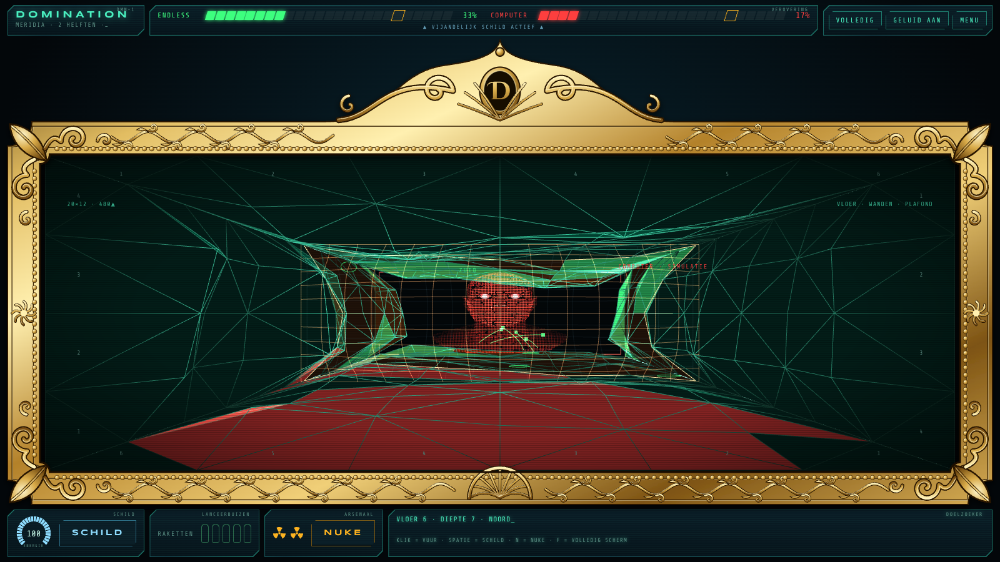
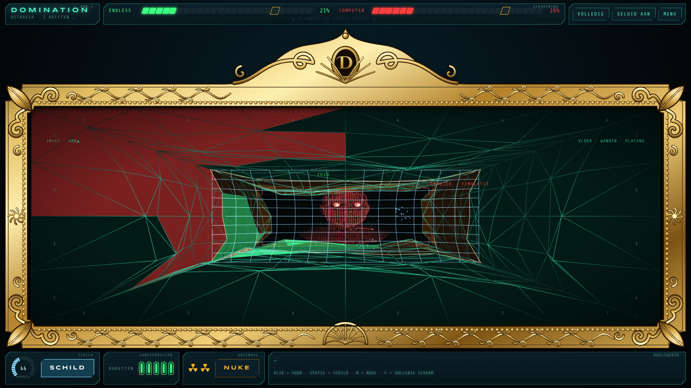
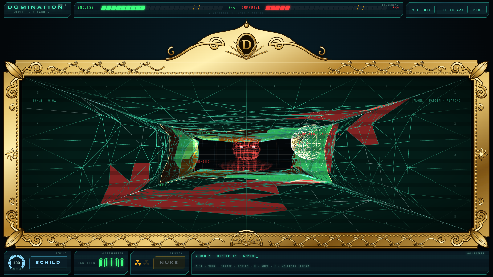
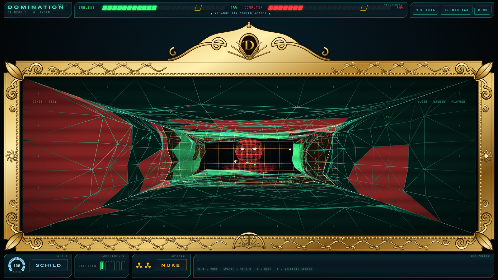
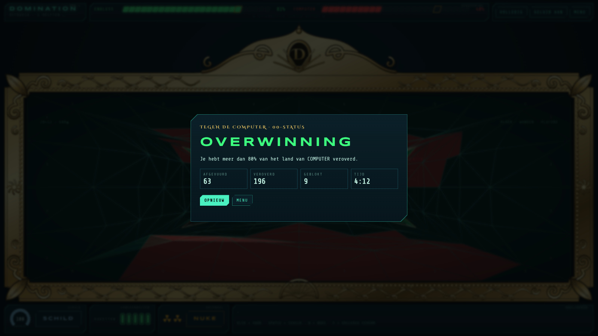
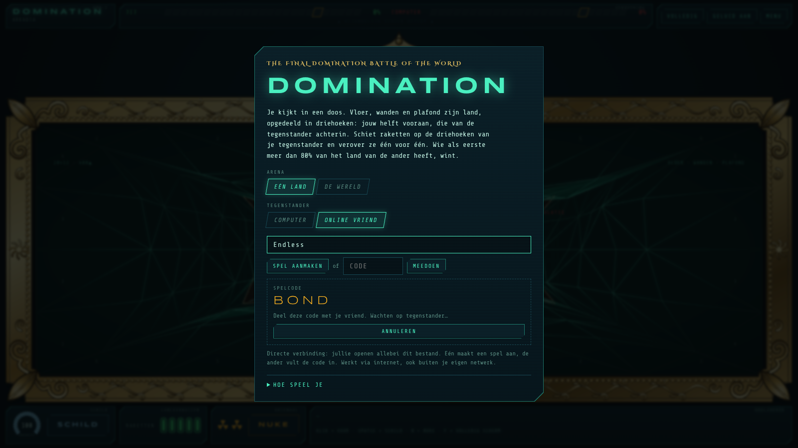
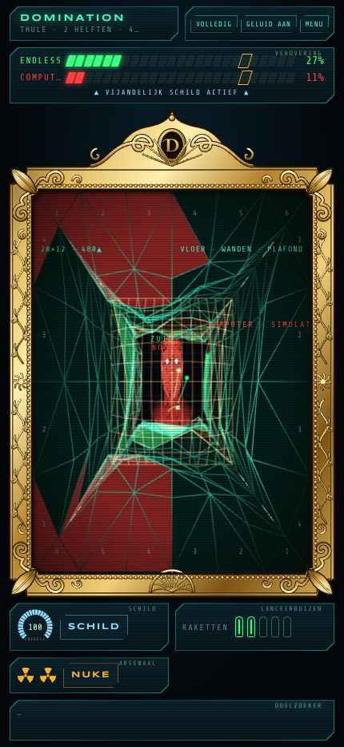

# Domination

**The final domination battle of the World.** Je kijkt in een doos waarvan de vloer, de wanden en het plafond land zijn, opgedeeld in driehoeken. Jouw helft ligt vooraan, die van je tegenstander achterin. Schiet raketten op zijn driehoeken, houd die van hem tegen met je schild, en verover als eerste meer dan 80% van zijn land.

Geïnspireerd op het Domination-spel uit de James Bond-film *Never Say Never Again* (1983).

### ▶ [Speel Domination](https://endless1977.github.io/Domination/)

## Spelregels

- **Raketten:** klik of tik op een driehoek van je tegenstander om een raket af te vuren. Er kunnen er maximaal 5 tegelijk vliegen.
- **Veroveren:** een raket die raak is, verovert die driehoek. Bij jou kleurt hij groen, bij je tegenstander rood. Veroverd blijft veroverd: terugveroveren kan niet.
- **Winnen:** wie als eerste meer dan 80% van het land van de ander heeft, wint.
- **Schild:** een parabool die jouw helft van de doos afsluit en naar de vijand toe bolt. Hij houdt inkomende raketten tegen, maar kost energie. Elke tegengehouden raket kost extra, en is de energie op, dan klapt het schild in.
- **Het schild werkt twee kanten op:** je eigen raketten die de parabool nog niet voorbij zijn, gaan ook kapot.
- **Nukes:** je hebt er 2. Eén nuke verovert een heel land, tenzij het schild van de ander hem stopt. Dat schild kost dan bijna de helft van zijn energie.

## Besturing

| Actie | Muis / touch | Toetsenbord |
|---|---|---|
| Raket afvuren | Klik of tik op een vijandelijke driehoek | |
| Schild | Houd **SCHILD** ingedrukt | Houd **Spatie** ingedrukt |
| Nuke | **NUKE**, daarna een vijandelijk land aanklikken | **N**, daarna klikken (**Esc** annuleert) |
| Volledig scherm | **VOLLEDIG** | **F** |

## Arena's en tegenstanders

- **Eén land:** ieder heeft één helft. Een nuke die niet wordt tegengehouden, wint dus meteen het spel.
- **De wereld:** beide helften zijn verdeeld in 4 landen; een nuke verovert er één.
- **Computer:** drie niveaus, *Rekruut*, *Agent* en *00-status*. Hoe hoger het niveau, hoe sneller hij schiet en hoe beter hij zijn schild op tijd gebruikt.
- **Online vriend:** speel samen via internet.

## Online samen spelen

1. Open allebei het spel en kies **Online vriend**. Vul eventueel een naam in.
2. Eén speler klikt op **Spel aanmaken** en krijgt een code van 4 letters.
3. De ander vult die code in en klikt op **Meedoen**.
4. Zodra hij verbonden is, start de host het gevecht.

De verbinding loopt via de openbare PeerJS-server en daarna rechtstreeks tussen jullie browsers. Thuis werkt dat normaal gesproken; strenge bedrijfs- of schoolnetwerken kunnen het blokkeren.

## Wat je ziet

- **De tegenstander op de achterwand:** een 3D-hoofd, in contourlijnen gesneden zoals een gezichtsscan. De ogen kijken naar waar hij op mikt en naar raketten die op hem afkomen. Ze knipperen, knijpen samen als jij raak schiet en gaan wijd open bij een inkomende nuke. Bij online spelen volgen ze waar je vriend met zijn muis mikt.
- **De gouden lijst:** het speelveld zit in een vergulde lijst in late-renaissancestijl, met een puntig fronton, krullen en acanthusbladeren. De lijst schaalt mee met je scherm.
- **De HUD:** oude sci-fi-instrumentpanelen met verovering per segment, een energiemeter, lanceerbuizen, nukes en een doelzoeker die laat zien op welke wand en diepte je mikt.
- **Op elk scherm:** volledig scherm met **F**, en het werkt ook op een telefoon.

## Screenshots

| | |
|---|---|
|  |  |
| **Startmenu:** kies arena, tegenstander en niveau | **Eén land:** een salvo onderweg, de computer zet zijn schild op |
|  |  |
| **Schild:** inkomende raketten spatten uiteen op de parabool | **Nuke:** één inslag en het hele land is groen |
|  |  |
| **De wereld:** acht landen over vloer, wanden en plafond | **Overwinning:** meer dan 80% veroverd |
|  |  |
| **Online:** deel de code met je vriend | **Mobiel:** hetzelfde spel op een telefoon |

## Techniek

- Eén HTML-bestand ([`index.html`](index.html)) zonder installatie of build: open het in de browser, of speel via GitHub Pages. Chrome of Edge aanbevolen.
- 3D met [three.js](https://threejs.org/) r128; online spelen via [PeerJS](https://peerjs.com/). Beide worden van een CDN geladen, dus je hebt internet nodig.
- Het gezichtsmodel zit in contourlijnen in het bestand zelf ingebakken.
- Lokaal spelen tegen de computer: download `index.html` en open het.

---

*Een fanproject. Niet verbonden aan of goedgekeurd door de makers of rechthebbenden van James Bond of* Never Say Never Again.
