# Domination

**The final domination battle of the World.** Je kijkt in een doos waarvan de vloer, de wanden en het plafond land zijn, opgedeeld in driehoeken. Jouw helft ligt vooraan, die van je tegenstander achterin. Schiet raketten op zijn driehoeken, houd die van hem tegen met je schild, en verover als eerste meer dan 80% van zijn land.

Geïnspireerd op het Domination-spel uit de James Bond-film *Never Say Never Again* (1983).

### ▶ [Speel Domination](https://endless1977.github.io/Domination/)

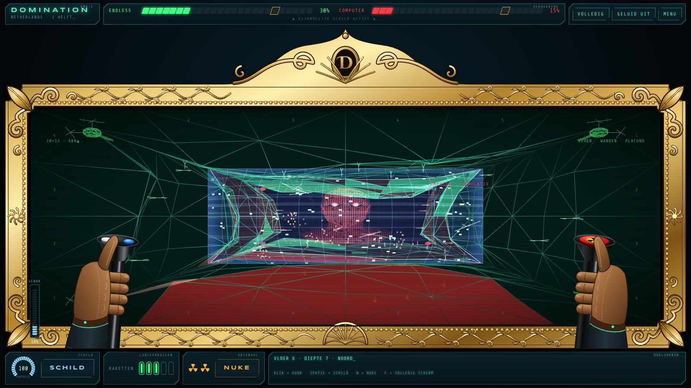

## Zo begint een gevecht

Kies een echt land, of de hele wereld, en druk op **Start gevecht**. Dan volgt eerst een holografische presentatie:

- **Een land:** de computer zoomt in op een hologram van het land en zegt met een robotstem *"Selected"* met de naam, en daarna *"Value"* met een geschatte waarde in dollars. Het land draait één keer langzaam rond. Daarna straalt de projectie uit, het land rolt zich op tot de tunnel en het slagveld verschijnt.
- **De wereld:** een draaiende wereldbol wordt plat gelegd als wereldkaart, draait langzaam rond terwijl de computer presenteert en wordt dan in de tunnel geprojecteerd.

Klik of druk op Spatie om de intro over te slaan. Online speelt de intro voor beide spelers helemaal af, zodat jullie tegelijk beginnen.

## Spelregels

- **Raketten:** klik of tik op een driehoek van je tegenstander om een raket af te vuren. Er kunnen er maximaal 5 tegelijk vliegen.
- **Door heuvels heen mikken:** klik je op een heuvel, dan gaat de raket naar het eerste vijandelijke vak op die lijn dat nog te veroveren is. Zo zijn ook vakken achter een heuvel te raken.
- **Veroveren:** een raket die raak is, verovert die driehoek. Bij jou kleurt hij groen, bij je tegenstander rood. Veroverd blijft veroverd: terugveroveren kan niet.
- **Winnen:** wie als eerste meer dan 80% van het land van de ander heeft, wint.
- **Schild:** een parabool met een blauwe waas en storingspixels, die jouw helft van de doos afsluit en naar de vijand toe bolt. Hij houdt inkomende raketten tegen, maar kost energie. Elke tegengehouden raket kost extra, en is de energie op, dan klapt het schild in.
- **Het schild werkt twee kanten op:** je eigen raketten die de parabool nog niet voorbij zijn, gaan ook kapot.
- **Nukes:** je hebt er 2. Een nuke is een echte raket die vanaf de vloer opstijgt. Eén nuke verovert een heel land, tenzij het schild van de ander hem stopt. Dat schild kost dan bijna de helft van zijn energie.
- **Turrets:** in de vier hoeken van jouw kant staan turrets. Zolang het gevecht loopt, vuren ze om de beurt een zoekende raket af op een vak waar niemand op mikt, bij voorkeur achterin. De tegenstander heeft ze ook.

## Besturing

| Actie | Muis / touch | Toetsenbord |
|---|---|---|
| Raket afvuren | Klik of tik op een vijandelijke driehoek | |
| Schild | Houd **SCHILD** of de blauwe knop op de linker joystick ingedrukt | Houd **Spatie** ingedrukt |
| Nuke | **NUKE** of de rode knop op de rechter joystick, daarna een vijandelijk land aanklikken | **N**, daarna klikken (**Esc** annuleert) |
| Intro overslaan | Klik in het beeld | **Spatie**, **Enter** of **Esc** |
| Volledig scherm | **VOLLEDIG** | **F** |

## Arena's en tegenstanders

- **Eén land:** kies een van 42 echte landen of laat het spel er een kiezen. Ieder heeft één helft, dus een nuke die niet wordt tegengehouden, wint meteen het spel.
- **De wereld:** beide helften zijn verdeeld in 4 landen; een nuke verovert er één.
- **Computer:** drie niveaus, *Rekruut*, *Agent* en *00-status*. Hoe hoger het niveau, hoe sneller hij schiet en hoe beter hij zijn schild op tijd gebruikt.
- **Online vriend:** speel samen via internet. Het land dat de host kiest, krijgt de gast ook.

## Online samen spelen

1. Open allebei het spel en kies **Online vriend**. Vul eventueel een naam in.
2. Eén speler klikt op **Spel aanmaken** en krijgt een code van 4 letters.
3. De ander vult die code in en klikt op **Meedoen**.
4. Zodra hij verbonden is, start de host het gevecht.

De verbinding loopt via de openbare PeerJS-server en daarna rechtstreeks tussen jullie browsers. Thuis werkt dat normaal gesproken; strenge bedrijfs- of schoolnetwerken kunnen het blokkeren.

## Wat je ziet

- **De tegenstander op de achterwand:** een 3D-hoofd, in contourlijnen gesneden zoals een gezichtsscan. De ogen kijken naar waar hij op mikt en naar raketten die op hem afkomen. Ze knipperen, knijpen samen als jij raak schiet en gaan wijd open bij een inkomende nuke. Bij online spelen volgen ze waar je vriend met zijn muis mikt.
- **De joysticks:** twee zwart glanzende sticks met een verzonken kop, vastgehouden door twee handen in leren handschoenen. Ze bewegen mee met je muis. Op de linker stick zitten een witte knop, die oplicht als je vuurt, en een blauwe knop voor het schild. De rechter stick heeft een grote rode knop met het stralingsteken voor de nuke.
- **Schokken:** word je geraakt, dan krijgen de handen een schok met bliksemschichten. De **SCHOK**-meter loopt op naar 100%. Die doet nog niets en is er voor een latere uitbreiding.
- **De oorlog eromheen:** kleine soldaatjes marcheren naar het front en beschieten elkaar, en vliegtuigjes vliegen door de tunnel en gooien bommen. Ze zijn er voor de sfeer en veroveren zelf niets.
- **Het vizier:** een X met een punt in het midden en open, afgeronde hoeken. Met een nuke klaar wordt het oranje.
- **De gouden lijst:** het speelveld zit in een vergulde lijst in late-renaissancestijl, met een puntig fronton, krullen en acanthusbladeren. De lijst schaalt mee met je scherm.
- **De HUD:** oude sci-fi-instrumentpanelen met verovering per segment, een energiemeter, lanceerbuizen, nukes en een doelzoeker die laat zien op welke wand en diepte je mikt.
- **Op elk scherm:** volledig scherm met **F**, en het werkt ook op een telefoon. Op een telefoon zijn de joysticks verborgen, zodat je het speelveld goed kunt zien.

## Screenshots

| | |
|---|---|
| 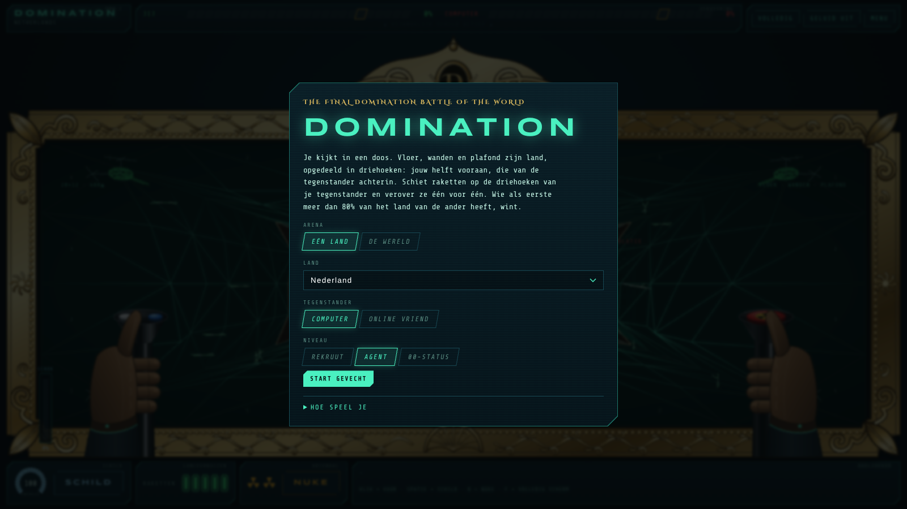 | 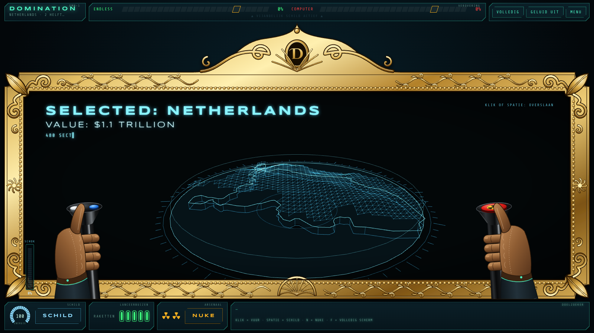 |
| **Startmenu:** kies arena, land, tegenstander en niveau | **Intro:** *Selected: Netherlands. Value: $1.1 trillion* |
| 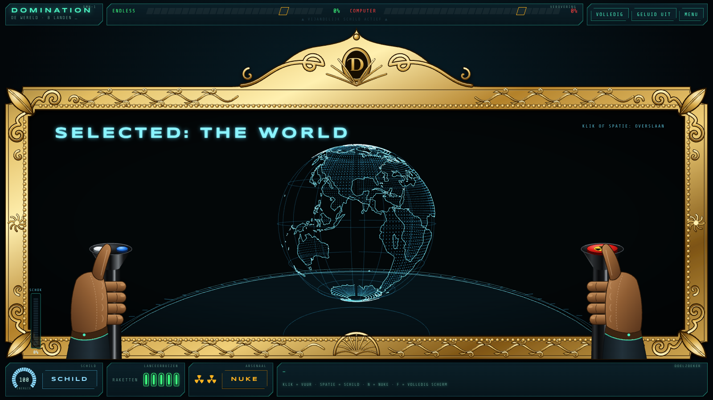 |  |
| **De wereld:** de draaiende wereldbol voor hij plat gaat | **Gevecht:** salvo onderweg, de computer zet zijn schild op |
| 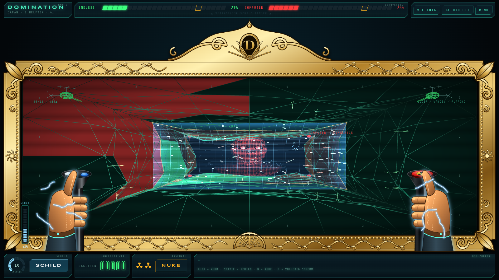 | 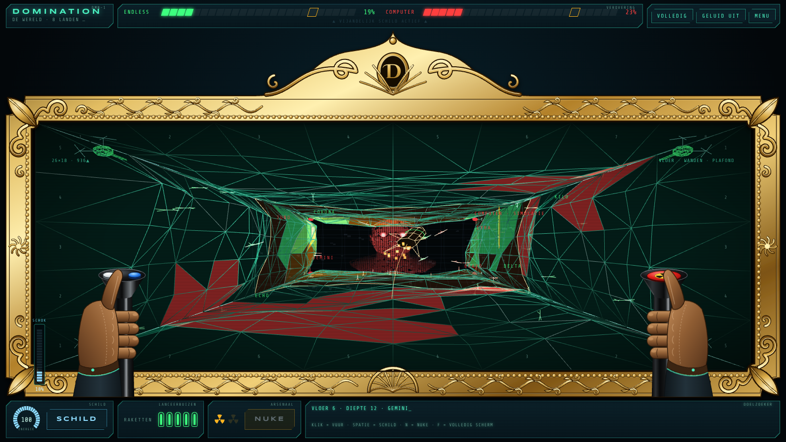 |
| **Schild en schok:** de blauwe waas, en bliksem omdat je geraakt bent | **Nuke:** de raket op weg naar een vijandelijk land |
| 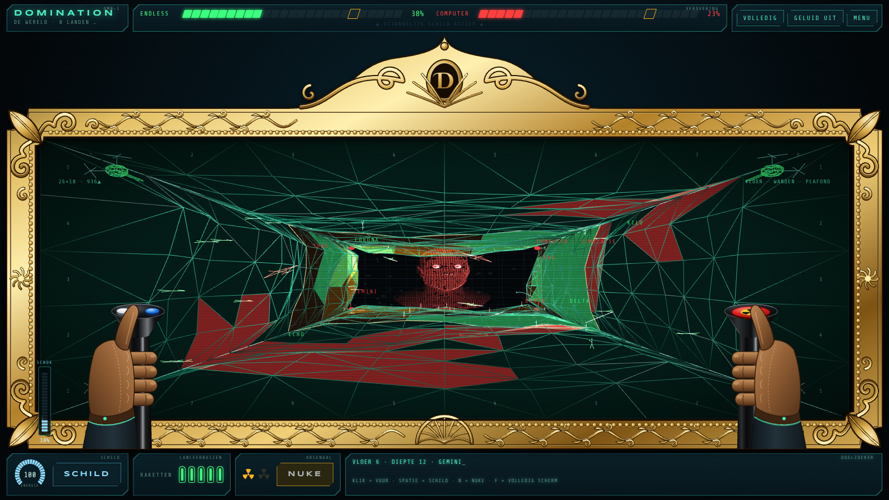 | 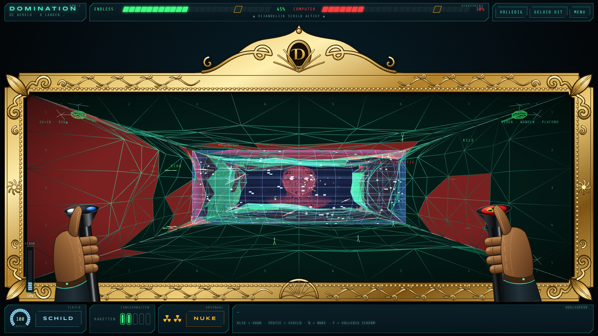 |
| **Inslag:** één nuke en het hele land is groen | **De wereld:** acht landen over vloer, wanden en plafond |
| 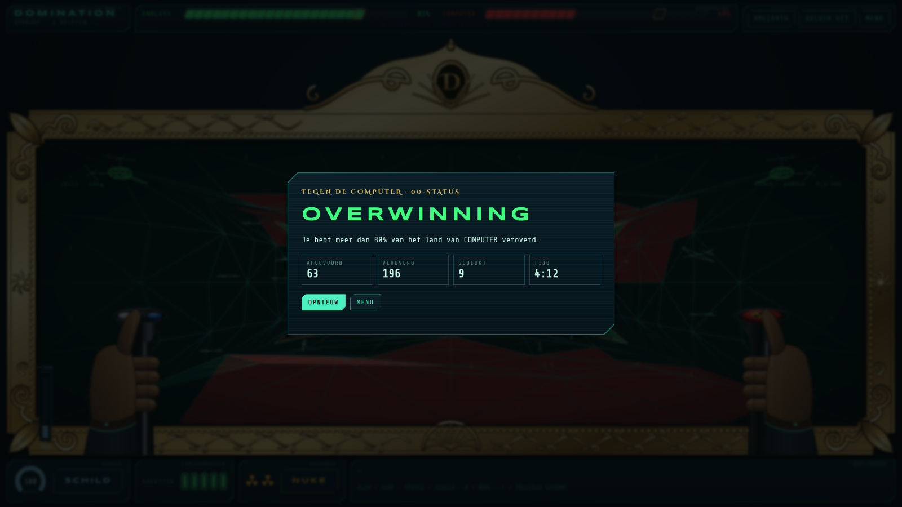 | 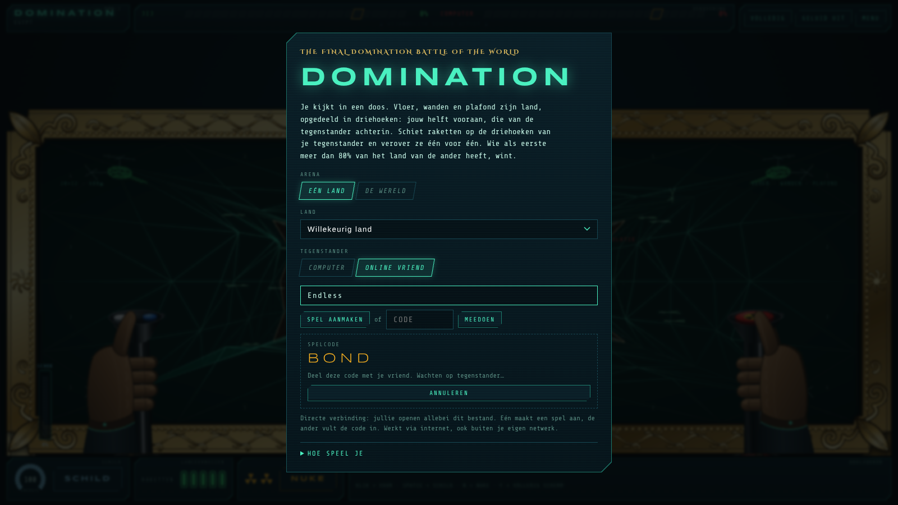 |
| **Overwinning:** meer dan 80% veroverd | **Online:** deel de code met je vriend |
| 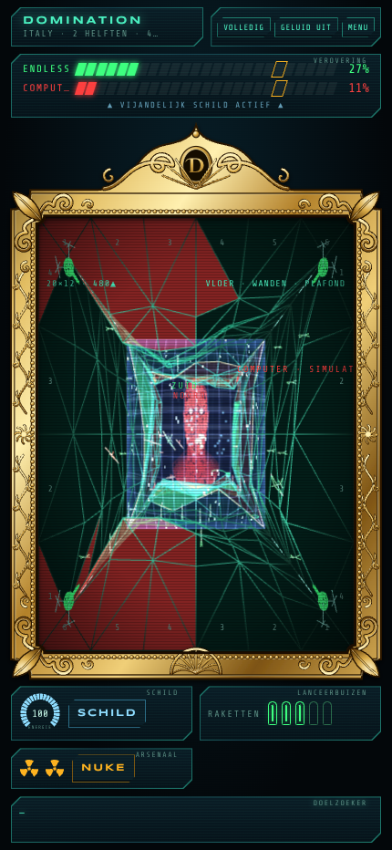 | |
| **Mobiel:** hetzelfde spel op een telefoon | |

## Techniek

- Eén HTML-bestand ([`index.html`](index.html)) zonder installatie of build: open het in de browser, of speel via GitHub Pages. Chrome of Edge aanbevolen.
- 3D met [three.js](https://threejs.org/) r128; online spelen via [PeerJS](https://peerjs.com/). Beide worden van een CDN geladen, dus je hebt internet nodig.
- De robotstem is de ingebouwde spraak van je browser, op een zo laag mogelijke toonhoogte. Welke stem je hoort, hangt af van je browser en systeem. Met **Geluid uit** zwijgt hij.
- Landgrenzen en de wereldkaart komen van [Natural Earth](https://www.naturalearthdata.com/) (publiek domein), via [world-atlas](https://github.com/topojson/world-atlas). Ze zitten in het bestand ingebakken, net als het gezichtsmodel.
- De *value* van een land is een grove schatting van wat het in een jaar verdient (het bbp, rond 2023), afgerond. Voor de wereld is dat ongeveer 105 biljoen dollar.
- Lokaal spelen tegen de computer: download `index.html` en open het.

---

*Een fanproject. Niet verbonden aan of goedgekeurd door de makers of rechthebbenden van James Bond of* Never Say Never Again.
